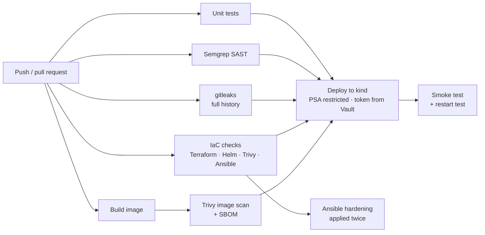

# VulnTrack — devsecops-pipeline-lab

[](https://github.com/nizaryart/devsecops-pipeline-lab/actions/workflows/devsecops.yml)

VulnTrack is a small self-hosted API that tracks vulnerability disclosures: the reports I send to vendors and bug bounty
programs, from first report to public disclosure. It works the way a vulnerability-management team does: it computes the
CVSS 3.1 base score from the vector, sets a remediation deadline from the severity, and only allows the status changes a
real workflow allows.

This repository is also how it gets shipped. Every change goes through the same chain:
tests → SAST → secret scanning → IaC checks → build → image scan → deploy to Kubernetes → smoke test.
Nothing reaches the cluster unless every gate passes.

## The pipeline



| Gate | Tool | Fails the pipeline when… |
|---|---|---|
| Unit tests | pytest (35 tests) | a test fails, including the CVSS reference vectors |
| SAST | Semgrep: `p/python` + [custom rules](.semgrep/) | any finding; the custom rules are unit-tested first |
| Secrets | gitleaks, every commit | a secret appears anywhere in the history |
| Infrastructure | `terraform fmt/validate`, `helm lint`, Trivy config, `ansible-lint --profile production`, actionlint | a lint error or a HIGH/CRITICAL misconfiguration |
| Image | Trivy on the saved image archive, CycloneDX SBOM | a HIGH/CRITICAL vulnerability that has a fix |
| Deploy | kind, Helm, Vault | the namespace accepts a privileged pod, the rollout fails, a smoke check fails, or data is lost on restart |
| Hardening | Ansible on the runner | an assertion fails, or the second run changes anything |

Each run publishes a readable summary of the findings, the SBOM and the scan reports as artifacts.

### What the deploy job proves

- **It deploys exactly what was scanned.** The image is built once, saved as `image.tar`, scanned, then loaded into the
  cluster from that same archive. Nothing is rebuilt between scan and deploy.
- **The namespace enforces the `restricted` Pod Security Standard.** Before deploying, the script asks the API server to
  admit a privileged pod (server-side dry run) and refuses to continue unless it is rejected.
- **The API token never touches the repository.** It is stored in Vault, read at deploy time, masked in the logs and
  written into a Kubernetes Secret through stdin. The chart only references an existing Secret.
- **The service works from the outside.** [`smoke-test.sh`](scripts/smoke-test.sh) checks the probes, refuses a missing
  or wrong token, checks the scoring and the status workflow, and
  [`check-persistence.sh`](scripts/check-persistence.sh) restarts the pod and checks that the data is still there.

## Run it locally

Requirements: Docker, Python 3.13, GNU make, curl.

```bash
scripts/install-tools.sh                       # pinned tools in .tools/bin, SHA-256 verified
python -m venv .venv && . .venv/bin/activate
pip install --require-hashes -r app/requirements.txt
pip install -r requirements-dev.txt
pip install -r ci/semgrep.txt -r ci/ansible.txt

make test sast iac                             # the same gates as CI
make build image-scan TAG=dev
export VULNTRACK_TOKEN="$(openssl rand -hex 32)"
make deploy smoke persistence TAG=dev          # kind cluster on your machine
make clean
```

To watch a gate fail without committing anything, write a fake key and scan that file:

```bash
echo "VULNTRACK_TOKEN=$(openssl rand -hex 24)" > leak.env
.tools/bin/gitleaks dir leak.env --no-banner   # exit code 1, rule generic-api-key
rm leak.env
```

## The application

| Method | Path | Auth | Purpose |
|---|---|---|---|
| GET | `/health` | none | liveness probe |
| GET | `/ready` | none | readiness probe (opens the database) |
| GET | `/api/findings?status=&overdue=` | Bearer | list findings, optionally only overdue ones |
| POST | `/api/findings` | Bearer | create a finding from a title, product and CVSS 3.1 vector |
| GET | `/api/findings/{id}` | Bearer | read one finding |
| PATCH | `/api/findings/{id}` | Bearer | move it to the next status |

```bash
curl -s -H "Authorization: Bearer $VULNTRACK_TOKEN" -H "Content-Type: application/json" \
  http://127.0.0.1:8080/api/findings \
  -d '{"title":"Unauthenticated file deletion","product":"example-plugin 1.2.3",
       "cvss_vector":"CVSS:3.1/AV:N/AC:L/PR:N/UI:N/S:U/C:N/I:H/A:H"}'
# -> score 9.1, severity "critical", due_on = reported_on + 7 days
```

| Severity | Deadline |
|---|---|
| Critical | 7 days |
| High | 30 days |
| Medium | 90 days |
| Low | 180 days |

Statuses: `reported → triaged → patched → disclosed`, and `reported/triaged → rejected`. Anything else returns 409.

Security choices in the code: every `/api` route sits on one router that requires the token, so a new route can't forget
it; the token is compared in constant time; the API refuses to serve (503) if no token is configured instead of running
open; queries are constant SQL with parameters; the OpenAPI schema is not exposed.

## Infrastructure

`infra/terraform` describes the single node that runs the cluster on AWS (eu-west-3):

- SSH and the Kubernetes API are reachable from `admin_cidr` only; a validation rule rejects `0.0.0.0/0`.
- IMDSv2 is required, the root volume is encrypted, the subnet never assigns public IPs, and VPC flow logs go to CloudWatch.
- Egress is limited to ports 80 and 443. Trivy flags open egress as CRITICAL; the two rules carry an inline exception
  with a reason and an expiry date, and CI fails again once it expires.

`infra/ansible/harden.yml` prepares the node: key-only SSH through a validated `sshd_config.d` drop-in, ufw (deny
incoming, rate-limited SSH), fail2ban, automatic security updates and kernel network settings. It ends by reading the
effective `sshd -T` configuration and failing if another file overrides the hardening.

CI validates and scans both, and applies the playbook to its own disposable runner. Creating the AWS resources is a
manual step, because it needs an account and costs money:

```bash
cd infra/terraform && cp terraform.tfvars.example terraform.tfvars   # edit admin_cidr and ssh_public_key
terraform init && terraform apply
cd ../ansible && cp inventory.example.ini inventory.ini              # put the node_public_ip output here
ansible-playbook harden.yml
```

## Design decisions

- **Distroless, non-root image.** No shell or package manager in the runtime image, user 65532, read-only root filesystem
  in Kubernetes, all capabilities dropped, `RuntimeDefault` seccomp.
- **Supply chain.** Python dependencies are locked with hashes (`pip --require-hashes`), base images and the Vault image
  are pinned by digest, GitHub Actions are pinned to commit SHAs, tools are downloaded at fixed versions and checked
  against hard-coded SHA-256 values, and the Terraform provider lock file is read-only in CI. Dependabot proposes the updates.
- **No third-party scanner actions.** The scanners run from verified binaries instead of community wrappers, so a moved
  tag on someone else's action can't change what runs in this pipeline.
- **Custom Semgrep rules.** `api-auth` catches a route under `/api` that would skip the token check (CWE-862, the bug
  class behind most of the plugin vulnerabilities I report). `sql` catches SQL built from runtime strings in `sqlite3`
  calls: the official `p/python`, `p/sql-injection` and `p/owasp-top-ten` rulesets did not flag that case when I tested them.
- **Accepted findings.** Trivy reports two LOW items on purpose: no `HEALTHCHECK` in the Dockerfile (distroless has no
  shell; Kubernetes probes do this job) and no customer-managed KMS key on the flow-log group (AWS encrypts it by default).

## GitLab CI

[`.gitlab-ci.yml`](.gitlab-ci.yml) runs the same stages on GitLab and adds two things the public GitHub run can't do: it
pushes the image to the registry only after the scans pass, and its manual deploy job logs in to Vault with a GitLab OIDC
token (`id_tokens` → Vault JWT auth) instead of a static credential. It is validated against GitLab's CI schema and its
shell lines with shellcheck; it does not run from this GitHub repository.

## Limits

- kind's default network plugin does not enforce NetworkPolicy; the policy in the chart needs a CNI such as Calico or Cilium.
- Vault runs in dev mode inside CI, and the job seeds the secret itself to play the ops team.
- SQLite on a ReadWriteOnce volume means one replica; that is enough for a personal tool, not for a team service.
